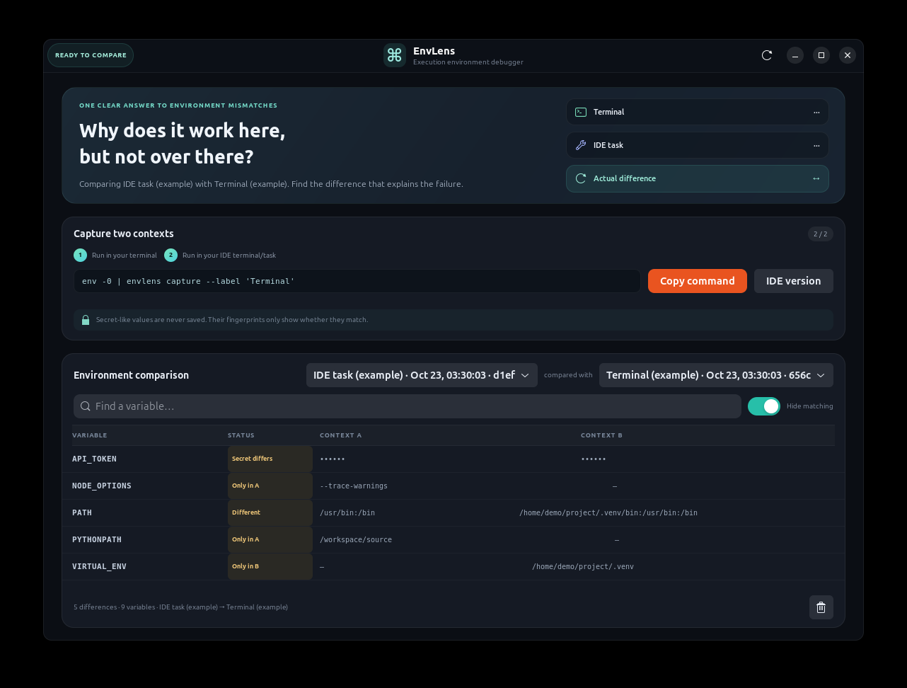
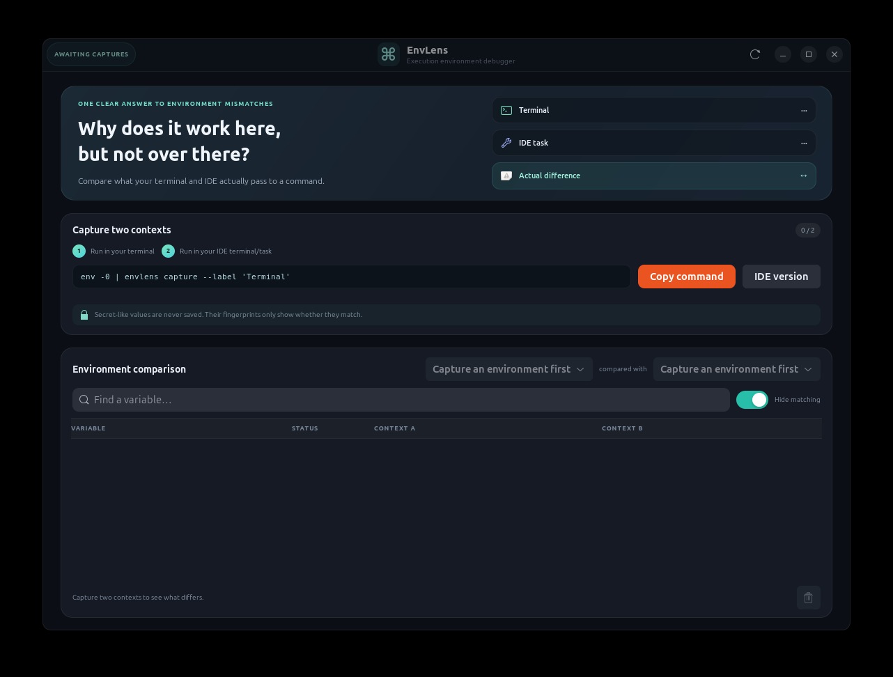

# EnvLens

**Why does it work in the terminal, but fail in the IDE?** EnvLens compares
the environment a command actually receives in each context. Capture both
contexts, then find differences in `PATH`, working directory, runtime settings
and other variables in a clean side-by-side view.



Built for Linux with Python 3, GTK4 and Libadwaita. Captures stay on your
computer; there is no account, service or telemetry.

## Install on Ubuntu

```bash
sudo apt update
sudo apt install python3-gi gir1.2-gtk-4.0 gir1.2-adw-1
git clone https://github.com/stevenmcsorley/envlens-desktop.git
cd envlens-desktop
./install.sh
```

Launch **EnvLens** from Applications, or run `~/.local/bin/envlens-gui`.
The standalone source launcher is `./bin/envlens-gui`.

For the Ubuntu package, build it with `./packaging/build-deb.sh` and install it
with `sudo apt install ./dist/envlens_1.0.0_all.deb`. Remove it with
`sudo apt remove envlens`. For a user install, run
`~/.local/share/envlens/uninstall.sh`; this removes the launcher but preserves
your capture data and secret-fingerprint key. No system service or root access
is required after installation.

## Capture two real contexts

First, open a terminal in your project and run:

```bash
env -0 | envlens capture --label 'Terminal'
```

Then run a capture from the context that fails. For an IDE integrated terminal:

```bash
env -0 | envlens capture --label 'IDE terminal'
```

For an IDE task, put the capture before the failing command. For example:

```bash
env -0 | envlens capture --label 'IDE build task' && npm run build
```

The capture command reads NUL-delimited environment data from standard input,
so values containing spaces or newlines remain intact. It saves a local
snapshot. Return to EnvLens and press the refresh button. Choose the two
contexts to compare, then search for a variable or hide matching rows.

If `envlens` is not on `PATH`, use the full path `~/.local/bin/envlens`. The
copy buttons in the app provide the terminal and IDE-terminal commands.

## Reading the comparison

- **Different:** both contexts define the variable, but with different values.
- **Only in A / Only in B:** the variable is absent from one captured context.
- **Same:** both values match.
- **Secret differs / Secret matches:** EnvLens compares a local keyed
  fingerprint and displays only bullets; it never saves the secret value.

Capture labels and timestamps identify each snapshot. The capture’s working
directory comes from the captured `PWD`; the shell is identified from `SHELL`.
Values under your home directory are shown with `~` in the comparison.

## Privacy and limits

Environment variables often contain credentials. EnvLens detects common secret
names such as `*_TOKEN`, `*_PASSWORD`, `*_SECRET`, `*_API_KEY` and credential
variables, along with common token formats. It stores only an HMAC fingerprint
for a detected secret. The key is kept separately in your private XDG state
directory; matching secret values can be compared across captures on the same
installation without revealing them. A secret copied to another computer will
not have a comparable fingerprint there.

Detection is heuristic. Review capture sources before sharing them, and don’t
share a capture directory or report if it contains private values. All capture
files have user-only permissions (`0600`) inside a private directory (`0700`).
The app keeps the most recent 100 captures; delete one with the bin button.

This first version captures the environment explicitly provided to the helper.
It doesn’t inspect arbitrary processes: Linux’s `/proc/PID/environ` may expose
only a process’s initial environment and may not reflect later changes. Capture
both sides from the actual shell or task context for a meaningful comparison.

## Screenshots

The repository screenshot uses clearly labelled example data, including a
fictional `PATH` mismatch and a sample token that EnvLens masks. Your own
captures and values will differ.

| Capture workflow | Difference review |
| --- | --- |
|  |  |

## Development

Use Ubuntu’s system Python to load GTK bindings:

```bash
PYTHONPATH=src /usr/bin/python3 -m envlens
PYTHONPATH=src /usr/bin/python3 -m unittest discover -s tests -v
```

The screenshots use synthetic example captures. To create the same example in
your own demo profile, set temporary `XDG_DATA_HOME` and `XDG_STATE_HOME`
directories, run `PYTHONPATH=src /usr/bin/python3
tools/create_example_captures.py`, then launch the app with those same
directories. The generator uses a fictional token and never reads your shell.

Python 3.10+, GTK 4 and Libadwaita 1.5+ are required. Contributions should
preserve the rule that secret values are never written into capture files.

## Existing tools

EnvLens is deliberately a small comparison tool, not a shell environment
manager. [mise](https://mise.jdx.dev/troubleshooting.html) can diagnose runtime
activation and PATH issues. EnvLens complements it by displaying the values
captured from two execution contexts side by side.

There are other projects named EnvLens, including terminal tools. This project
is the GTK desktop environment-comparison app; the GitHub repository is named
`envlens-desktop` to distinguish it.

## License

[MIT](LICENSE) © 2026 Steven McSorley.
